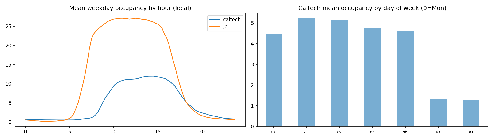

# EV Station Occupancy Forecasting

This project prepares ACN-Data charging-session records from the Caltech and JPL sites for forecasting the number of plugged-in electric vehicles. The current milestone covers data cleaning, a data-quality audit, exploratory plots, and preparation of training, validation, and test datasets. Forecasting-model training and evaluation are not yet included.

## Repository structure

```text
EV-station-forecasting/
├── README.md
├── data_audit.ipynb             # Main workflow, with explanations and comments
├── acn_dataset/
│   └── acn_<site>_<YYYY>_<MM>.json  # Raw monthly charging-session records
└── outputs/
    ├── figures/                # Saved PNG plots
    ├── tables/                 # Saved CSV audit tables
    ├── caltech_occupancy_data.npz
    └── jpl_occupancy_data.npz
```

## Dependencies and setup

Use Python 3.11 with the following packages:

| Package | Purpose |
| --- | --- |
| NumPy | Numerical arrays, sliding windows, and compressed dataset files |
| pandas | Loading, cleaning, and aggregating session data |
| Matplotlib | Audit and occupancy plots |
| holidays | California holiday indicators |
| JupyterLab and ipykernel | Running the notebook interactively |
| nbconvert | Running the notebook from the command line |

The notebook also uses Python's built-in `glob`, `json`, `os`, and `pathlib` modules; these require no separate installation.

Clone the repository and enter its root directory:

```bash
git clone https://github.com/JamalEddineEb/EV-station-forecasting.git
cd EV-station-forecasting
python -m venv .venv
```

Activate the environment on macOS/Linux:

```bash
source .venv/bin/activate
```

Or on Windows PowerShell:

```powershell
.venv\Scripts\Activate.ps1
```

Install the dependencies and register the notebook kernel:

```bash
python -m pip install "numpy>=1.20,<2" "pandas>=1.5,<2" matplotlib holidays jupyterlab ipykernel nbconvert
python -m ipykernel install --user --name ev-station-forecasting --display-name "EV Station Forecasting"
```

These version ranges are compatibility constraints, not a fully pinned environment. The pandas constraint preserves the timestamp-parsing behavior used by the current notebook.

## How to run from raw data

The raw JSON files are included in `acn_dataset/`. Each file contains a list of session records, and the filename identifies the site. No preprocessed output or API credentials are needed to run the workflow.

Run all commands from the repository root so that the relative paths `./acn_dataset` and `./outputs` resolve correctly. No machine-specific absolute paths are required.

### Option 1: JupyterLab

```bash
python -m jupyterlab
```

1. Open `data_audit.ipynb`.
2. Select the **EV Station Forecasting** kernel.
3. Choose **Restart Kernel and Run All Cells** to execute the notebook in order from raw data.

### Option 2: Command line

```bash
python -m jupyter nbconvert --to notebook --execute data_audit.ipynb --ExecutePreprocessor.kernel_name=ev-station-forecasting --ExecutePreprocessor.timeout=-1 --output data_audit_executed.ipynb --output-dir=.
```

This also saves an executed notebook as `data_audit_executed.ipynb` in the repository root. Both options create the output directories automatically and overwrite generated artifacts with the same filenames. Window generation can use substantial memory because it materializes overlapping samples.

## What the notebook does

1. Loads the raw monthly files, assigns site labels, flattens `userInputs`, and parses timestamps into UTC.
2. Flags data-quality issues and removes duplicate session IDs, invalid session times, and suspected stuck sessions. Negative delivered-energy values are set to missing while retaining the session.
3. Saves audit tables and exploratory plots.
4. Builds occupancy on a **15-minute grid**, rounding arrivals down and departures up to count each interval touched by a session.
5. Creates local-time calendar features using `America/Los_Angeles`: sine/cosine encodings for hour and weekday, plus a California holiday indicator.
6. Builds samples using **672 past intervals (one week)** to predict **16 future intervals (four hours)**. Windows touching zero-occupancy runs of at least five days are excluded.
7. Splits valid forecasting origins chronologically into approximately **70% training, 15% validation, and 15% test**, removing targets that cross into the next split, then saves the arrays.

The feature-engineering section sets the effective lookback to `L = 672`, overriding the earlier setup value. Edit the settings in that section when changing the lookback or forecast horizon. The inactive-period filter assumes 96 intervals per day, so changing the grid frequency also requires updating that filter.

## Where outputs are saved

All generated data artifacts are saved under `outputs/`:

| Location | Contents |
| --- | --- |
| `outputs/tables/missingness.csv` | Percentage of missing values by field before cleaning |
| `outputs/tables/summary_stats.csv` | Numeric summary statistics before cleaning |
| `outputs/tables/sessions_per_site_year.csv` | Cleaned session counts by site and year |
| `outputs/tables/example_rows.csv` | Five example cleaned sessions, transposed for inspection |
| `outputs/figures/distributions.png` | Session-duration, delivered-energy, and site-count plots |
| `outputs/figures/correlation.png` | Correlations between numeric session fields |
| `outputs/figures/occupancy_profiles.png` | Occupancy patterns by local time and weekday |
| `outputs/figures/occupancy_drift.png` | Monthly mean occupancy over time |
| `outputs/caltech_occupancy_data.npz` | Caltech forecasting arrays and split assignments |
| `outputs/jpl_occupancy_data.npz` | JPL forecasting arrays and split assignments |

For each split (`train`, `val`, and `test`), an `.npz` file stores:

- `<split>_X_hist`: past occupancy, shape `(samples, 672)`.
- `<split>_X_cal`: calendar features for the forecast horizon, shape `(samples, 16, 5)`.
- `<split>_y`: target occupancy, shape `(samples, 16)`.
- `<split>_origins`: integer positions of the first target interval in the full time series.

Each file also includes `origins` (all valid forecasting origins) and `timestamps` (the full UTC time index as strings). These shapes describe the current notebook settings; rerun the notebook to regenerate artifacts after changing settings.

To inspect a generated dataset:

```python
import numpy as np

with np.load("outputs/caltech_occupancy_data.npz", allow_pickle=False) as data:
    for name in data.files:
        print(name, data[name].shape, data[name].dtype)
```

Saved artifacts are already included in the repository, including this occupancy plot:



The repository also contains `arrivals_profiles.png`, `arrivals_drift.png`, and `quality_report.csv` from earlier work. The current notebook does not regenerate those three files.

## Course submission

Repository: [EV-station-forecasting on GitHub](https://github.com/JamalEddineEb/EV-station-forecasting).

Before submitting, commit and push the latest notebook, README, raw data, and at least one saved output artifact. Share the repository URL with the TA and instructor; if the repository is private, give both access. Restart and run all notebook cells before submission to confirm that the submitted version reproduces the outputs.
